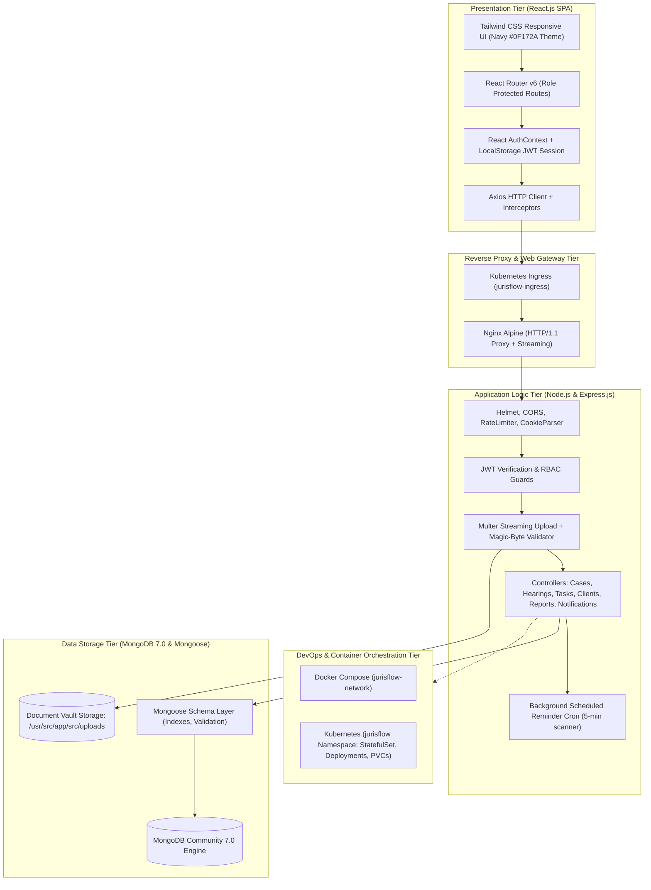
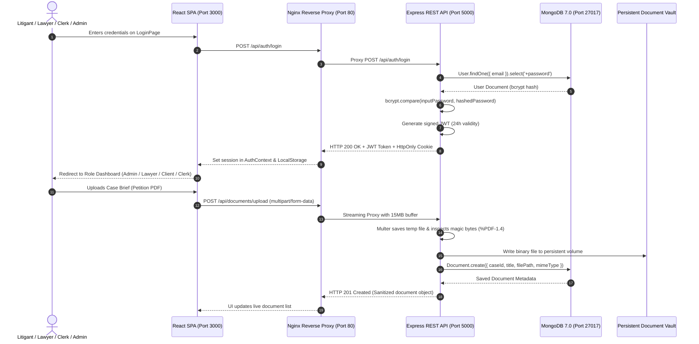
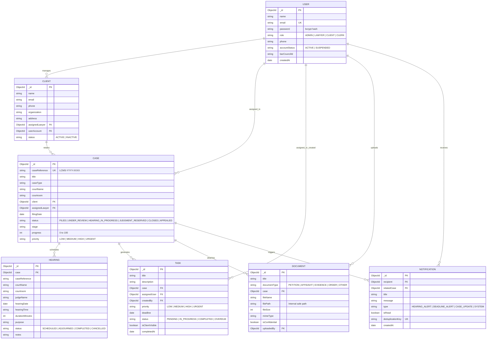
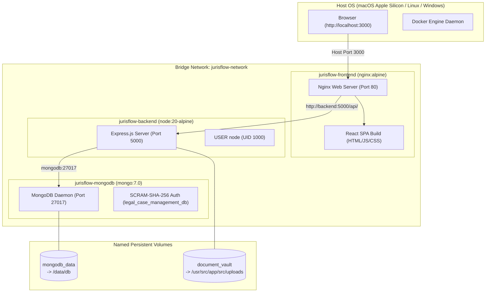
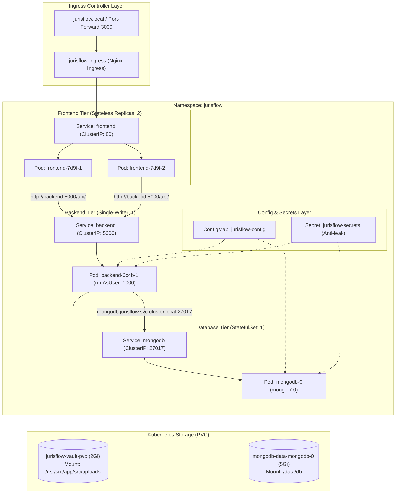

# JurisFlow System Architecture & Technical Design Specification

**Project:** Legal Case and Court Hearing Management Portal (JurisFlow)  
**Student:** MAMILLAPALLY ABHISHEK  
**Roll Number:** 2303A51762  
**Course:** DevOps & Full Stack (B.Tech IV Year I Semester)  
**Academic Year:** 2026–2027  

---

## 1. Overall System Architecture

JurisFlow is architected as an enterprise-grade, multi-tiered full-stack legal practice management portal adhering to micro-tier separation of concerns:

---

## 2. Frontend / Backend / Database Communication Flow

---

## 3. MongoDB Entity-Relationship (ER) Architecture

The database model is composed of **seven interconnected collections** with strict Mongoose validation, compound indexes, and relational integrity:

---

## 4. User Role-Based Access Control (RBAC) Matrix

| Capability / API Boundary | Admin | Lawyer | Litigant Client | Court Clerk |
| :--- | :---: | :---: | :---: | :---: |
| **System Administration** (User CRUD & Role Assignments) | ✅ Full Access | ❌ HTTP 403 | ❌ HTTP 403 | ❌ HTTP 403 |
| **Client Management** (Register, Edit, View Case History) | ✅ Full Access | 👁️ Assigned Only | ❌ HTTP 403 | ✅ Register & Maintain |
| **Case Registration** (Generate `LCMS-YYYY-XXXX`) | ✅ Full Access | ❌ HTTP 403 | ❌ HTTP 403 | ✅ Registry Filing |
| **Case Record Viewing** | ✅ All Dockets | 👁️ Assigned Only | 👁️ Own Matters Only | ✅ All Dockets |
| **Case Progress & Stage Editing** | ✅ Full Access | ✅ Assigned Cases | ❌ HTTP 403 | ✅ Cause Entry |
| **Hearing Scheduling & Rescheduling** | ✅ Full Access | ✅ Assigned Cases | 👁️ Read-Only | ✅ Registry Scheduling |
| **Schedule Conflict Detection (Courtroom/Judge)** | ✅ Enforced | ✅ Enforced | N/A | ✅ Enforced |
| **Document Vault Upload & Streaming Download** | ✅ Full Access | ✅ Assigned Cases | 👁️ Non-confidential | ✅ Registry Filing |
| **Confidential Document Protection** | ✅ Allowed | ✅ Allowed | ❌ HTTP 403 Guard | ✅ Allowed |
| **Task Assignment & Overdue Tracking** | ✅ Full Access | ✅ Assigned/Created | 👁️ Designated items | ✅ Registry Tasks |
| **Reports & CSV/PDF Analytics Engine** | ✅ All 4 Reports | 👁️ Practice Summary | ❌ HTTP 403 | 👁️ Cause & Task List |
| **In-App Notifications & Reminders** | ✅ Yes | ✅ Yes | ✅ Yes | ✅ Yes |

---

## 5. Docker Compose Multi-Container Topology (Phase 12)

---

## 6. Kubernetes Cluster Architecture (Phase 13)

