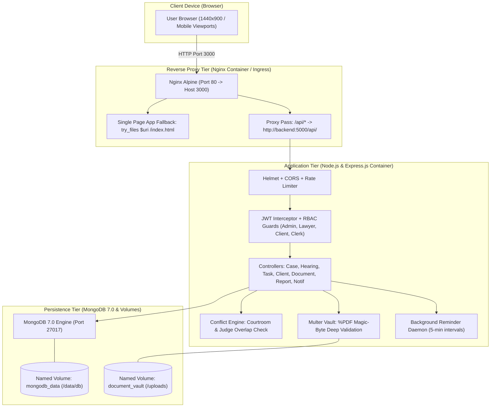
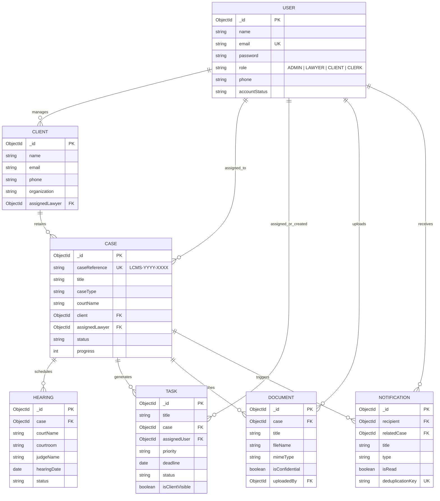
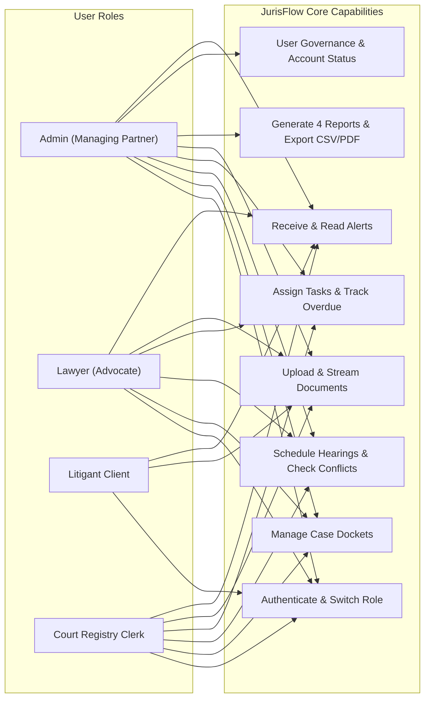

# JURISFLOW — LEGAL CASE AND COURT HEARING MANAGEMENT PORTAL
## Comprehensive B.Tech Final Project Documentation & Engineering Report

---

### Academic Information & Authorship
- **Candidate Name:** MAMILLAPALLY ABHISHEK
- **Hall Ticket / Roll Number:** 2303A51762
- **Degree & Branch:** Bachelor of Technology (B.Tech) in Computer Science & Engineering
- **Year & Semester:** IV Year I Semester
- **Course Title:** DevOps & Full Stack
- **Academic Year:** 2026–2027
- **Submission Date:** November 2026

---

## Table of Contents

1. [Introduction](#1-introduction)
2. [Problem Statement](#2-problem-statement)
3. [Objectives](#3-objectives)
4. [Existing System](#4-existing-system)
5. [Proposed System](#5-proposed-system)
6. [System Requirements](#6-system-requirements)
7. [Technology Stack](#7-technology-stack)
8. [System Architecture](#8-system-architecture)
9. [Database Design](#9-database-design)
10. [Entity-Relationship (ER) Diagram](#10-entity-relationship-er-diagram)
11. [Use Case Diagram & Workflows](#11-use-case-diagram--workflows)
12. [Module Descriptions](#12-module-descriptions)
13. [Authentication & Role-Based Access Control (RBAC)](#13-authentication--role-based-access-control-rbac)
14. [Client & Case Management](#14-client--case-management)
15. [Court Hearing Calendar & Conflict Prevention](#15-court-hearing-calendar--conflict-prevention)
16. [Task Management & Deadline Tracking](#16-task-management--deadline-tracking)
17. [Document Vault & Binary Security](#17-document-vault--binary-security)
18. [Notification Center & Reminder Scanner](#18-notification-center--reminder-scanner)
19. [Four Mandatory Reports & Export Engine](#19-four-mandatory-reports--export-engine)
20. [Four Role Dashboards](#20-four-role-dashboards)
21. [Docker & Docker Compose Containerization](#21-docker--docker-compose-containerization)
22. [Kubernetes Manifests & Orchestration](#22-kubernetes-manifests--orchestration)
23. [Testing, Benchmarking & Quality Assurance](#23-testing-benchmarking--quality-assurance)
24. [Security Architecture & Defense-in-Depth](#24-security-architecture--defense-in-depth)
25. [Visual Interface & Screenshots Guide](#25-visual-interface--screenshots-guide)
26. [Experimental Results & Verification](#26-experimental-results--verification)
27. [System Limitations](#27-system-limitations)
28. [Future Enhancements](#28-future-enhancements)
29. [Conclusion](#29-conclusion)
30. [References](#30-references)

---

## 1. Introduction

The legal profession in India and worldwide relies heavily on precise scheduling, strict procedural timelines, extensive evidentiary documentation, and rapid communication across judicial hierarchies. Court appearance dates, interim orders, filing deadlines, and client conferences are critical; missing a listing date before a High Court or District Tribunal can lead to dismissal for default or significant prejudice to litigant rights.

**JurisFlow (Legal Case and Court Hearing Management Portal)** is an enterprise full-stack web application engineered to bridge the operational gap between legal counsels, litigants, administrative law partners, and court registry clerks. Built with modern full-stack web technologies (React.js, Node.js, Express.js, MongoDB) and orchestrated through DevOps industry standards (Docker, Docker Compose, Kubernetes), JurisFlow establishes a unified platform for legal practice automation.

---

## 2. Problem Statement

Traditional legal practices suffer from severe procedural friction:
1. **Manual Diary Reliance:** Advocate diaries and paper cause lists lead to scheduling errors and overlooked court listing dates.
2. **Double-Booking & Courtroom Clashes:** Lawyers frequently discover overlapping courtroom appearances or concurrent hearings scheduled across different judges only on the morning of a hearing.
3. **Document Insecurity:** Case briefs, pleadings, and confidential affidavits stored in unencrypted folders or messaging apps risk unauthorized data exposure and lack file-level access controls.
4. **Litigant Anxiety & Poor Communication:** Clients lack visibility into their case proceedings, causing unnecessary telephone calls and administrative overhead for clerks.
5. **Deployment & Scaling Inefficiencies:** Legacy legal software is often monolithic, desktop-bound, or tied to proprietary closed ecosystems, lacking automated containerized deployment, self-healing, and persistent cloud backup.

---

## 3. Objectives

The primary engineering objectives of JurisFlow are:
- **Unified Role Isolation:** Implement strict Role-Based Access Control (RBAC) isolating Admin, Lawyer, Litigant Client, and Court Registry Clerk workflows.
- **Automated Case Reference System:** Auto-generate unique, collision-free docket numbers in the format `LCMS-YYYY-XXXX`.
- **Intelligent Schedule Conflict Engine:** Detect and block overlapping hearings for identical courtrooms or judges with mathematical time collision checks (HTTP 409 Conflict).
- **Hardened Document Vault:** Stream, validate, and store legal briefs up to 10 MB, enforcing magic-byte header inspection (`%PDF-1.4`) to prevent disguised script execution.
- **Automated Deadline & Listing Alerts:** Execute a recurring background cron scanner dispatching real-time notifications for hearings within 48 hours and tasks due within 24 hours.
- **Enterprise Reporting:** Deliver four real-time reports with RFC 4180 compliant CSV exports and print-formatted PDF generation.
- **Production Containerization & DevOps:** Containerize frontend (multi-stage Nginx) and backend (non-root Node.js), orchestrate via Docker Compose, and provide production-ready Kubernetes manifests.

---

## 4. Existing System

Existing practice management approaches fall into three flawed categories:
1. **Paper-Based Manual Registries:** Cause lists maintained manually in registers, vulnerable to physical damage, loss, and transcription errors.
2. **Generic Office Suites (Excel / Spreadsheets):** Lacks role-based data isolation, audit trails, and automatic conflict detection; confidential documents are accessible to anyone with file access.
3. **Proprietary Monolithic Legal Software:** Expensive, complex to configure, closed-source, and lacking standard DevOps CI/CD containerization or Kubernetes scaling.

---

## 5. Proposed System

JurisFlow provides an integrated, containerized, open-architecture solution:
- **Responsive Web Presentation:** Single Page Application (SPA) built with React 18, Vite, and Tailwind CSS.
- **Robust REST API Backend:** Node.js 20 LTS and Express.js featuring modular routes, controllers, and services.
- **Schema-Enforced NoSQL Database:** MongoDB Community 7.0 utilizing Mongoose ODM with compound indexes and relational references.
- **Zero-Trust Security:** JWT stateless authentication, bcrypt password hashing, non-root container users, and anti-privilege escalation guards.
- **Cloud-Native DevOps:** Complete Docker Compose multi-container setup with persistent named volumes and 13 production Kubernetes manifests for cluster deployment.

---

## 6. System Requirements

### Hardware Requirements
- **Processor:** 64-bit multi-core CPU (Intel Core i5/i7/Apple Silicon M1/M2/M3).
- **RAM:** 8 GB minimum (16 GB recommended for running Docker and local Kubernetes).
- **Storage:** 10 GB available SSD storage for container images and persistent volumes.
- **Network:** Localhost TCP network connection.

### Software Requirements
- **Operating System:** macOS (Apple Silicon/Intel), Ubuntu Linux 22.04 LTS, or Windows 11 with WSL2.
- **Runtime:** Node.js v20.x LTS, npm v10.x.
- **Containerization:** Docker Desktop v24+ / Docker Engine v24+, Docker Compose v2.20+.
- **Orchestration:** `kubectl` v1.28+, compatible with Minikube, Kind, or Docker Desktop K8s.
- **Browser:** Modern web browser supporting HTML5 and ES6 (Google Chrome 120+, Firefox, Safari).

---

## 7. Technology Stack

| Tier | Technology | Version | Purpose |
| :--- | :--- | :--- | :--- |
| **Frontend** | React.js | 18.3.1 | Component-based reactive UI library |
| **Build Tool** | Vite | 5.4.14 | Rapid development server & Rollup production bundler |
| **Styling** | Tailwind CSS | 3.4.17 | Utility-first responsive design system |
| **Icons** | Lucide React | 0.468.0 | Vector UI iconography |
| **HTTP Client** | Axios | 1.7.9 | Promise-based HTTP client with request/response interceptors |
| **Routing** | React Router DOM | 6.28.1 | Declarative client-side SPA routing |
| **Backend** | Node.js | 20.x LTS | Server-side JavaScript runtime |
| **API Framework**| Express.js | 4.21.2 | Modular REST API routing and middleware pipeline |
| **Database** | MongoDB | 7.0 Community | High-performance document database |
| **ODM Layer** | Mongoose | 8.8.4 | Object Data Modeling with schema validation |
| **Security** | jsonwebtoken | 9.0.2 | Signed stateless authentication tokens |
| **Hashing** | bcryptjs | 2.4.3 | Adaptive Blowfish one-way password hashing (salt: 10) |
| **HTTP Headers** | Helmet | 8.0.0 | Defense-in-depth HTTP security headers |
| **Uploads** | Multer | 1.4.5-lts.1 | Streaming multipart/form-data upload handler |
| **Rate Limiter** | express-rate-limit | 8.7.3 | Brute-force authentication flood defense |
| **Proxy / Server**| Nginx | 1.25 Alpine | Reverse proxy, static server, and gzip compression |
| **DevOps** | Docker & Compose | 24+ / 2.20+ | Multi-container packaging and volume management |
| **Orchestration**| Kubernetes | 1.28–1.32 | Container orchestration manifests and scaling rules |

---

## 8. System Architecture

JurisFlow follows a decoupled three-tier architectural paradigm:

---

## 9. Database Design

The data architecture comprises **seven collections** designed with relational references, strict enums, timestamps, and indexes:

| Collection Name | Document Count | Key Attributes | Mongoose References & Foreign Keys |
| :--- | :---: | :--- | :--- |
| **`users`** | 19 | `name`, `email`, `password`, `role`, `phone`, `accountStatus`, `barCouncilId` | None (Root identity entity) |
| **`clients`** | 10 | `name`, `email`, `phone`, `organization`, `address`, `status` | `assignedLawyer` → `users._id`, `userAccount` → `users._id` |
| **`cases`** | 34 | `caseReference`, `title`, `caseType`, `courtName`, `status`, `stage`, `progress` | `client` → `clients._id`, `assignedLawyer` → `users._id` |
| **`hearings`** | 42 | `courtName`, `courtroom`, `judgeName`, `hearingDate`, `hearingTime`, `purpose`, `status` | `case` → `cases._id` |
| **`tasks`** | 52 | `title`, `description`, `priority`, `deadline`, `status`, `isClientVisible` | `case` → `cases._id`, `assignedUser` → `users._id`, `createdBy` → `users._id` |
| **`documents`** | 22 | `title`, `documentType`, `fileName`, `filePath`, `fileSize`, `isConfidential` | `case` → `cases._id`, `uploadedBy` → `users._id` |
| **`notifications`**| 32 | `title`, `message`, `type`, `isRead`, `deduplicationKey`, `createdAt` | `recipient` → `users._id`, `relatedCase` → `cases._id` |

---

## 10. Entity-Relationship (ER) Diagram

---

## 11. Use Case Diagram & Workflows

---

## 12. Module Descriptions

JurisFlow is architecturally partitioned into eight modular subsystems:
1. **Authentication & Identity Module (`src/routes/auth.routes.js`):** JWT generation, cookie handling, registration sanitization, password updates.
2. **User Administration Module (`src/routes/user.routes.js`):** User CRUD, role toggles, status suspension.
3. **Client Registry Module (`src/routes/client.routes.js`):** Client contact directory, corporate affiliations, case histories.
4. **Case Management Module (`src/routes/case.routes.js`):** Docket creation (`LCMS-YYYY-XXXX`), litigation stage tracking, progress calculation.
5. **Court Hearing Calendar Module (`src/routes/hearing.routes.js`):** Cause roster, calendar grid, conflict detection engine.
6. **Task & Deadline Module (`src/routes/task.routes.js`):** Kanban assignment, priority badges, automated overdue calculation.
7. **Document Vault Module (`src/routes/document.routes.js`):** Multer streaming upload, magic-byte inspection, role confidentiality guards.
8. **Reports & Analytics Module (`src/routes/report.routes.js`):** 4 mandatory reports, aggregate summaries, RFC 4180 CSV engine.

---

## 13. Authentication & Role-Based Access Control (RBAC)

### Security Flow
1. **Password Hashing:** User passwords are encrypted with `bcryptjs` using 10 salt rounds before storage.
2. **Stateless Tokens:** Upon authentication, the backend signs a JWT with `id`, `email`, and `role`, expiring in 24 hours.
3. **Dual Transmission:** Delivered in JSON payload (`data.token`) and inside an `HttpOnly`, `SameSite: lax` cookie.
4. **RBAC Guard:** `authorizeRoles(...roles)` middleware halts unauthorized requests with HTTP 403 Forbidden.
5. **Privilege Escalation Defense:** Public self-registration (`/api/auth/register`) enforces `role: 'CLIENT'`.

---

## 14. Client & Case Management

- **Unique Reference Format:** `LCMS-YYYY-XXXX` (e.g. `LCMS-2026-0001`).
- **Litigation Statuses:** `FILED`, `UNDER_REVIEW`, `HEARING_IN_PROGRESS`, `JUDGMENT_RESERVED`, `CLOSED`, `APPEALED`.
- **Caseload Partition Guarantee:**
  $$\text{Active (14)} + \text{Pending (11)} + \text{Closed (9)} = 34 \text{ Total Cases}$$
- **Litigant Isolation:** Litigant Clients can only retrieve cases where their client profile matches `case.client`.

---

## 15. Court Hearing Calendar & Conflict Prevention

- **Cause List Rostering:** Tabular daily cause listings and interactive 7x5 monthly calendar views.
- **Atomic Collision Detection:** `conflict.service.js` inspects overlapping time ranges:
  - **Courtroom Clashes:** Blocks double-booking of identical physical courtrooms.
  - **Judge Double-Booking:** Blocks scheduling the same judicial bench concurrently.
- **Collision Error:** Throws HTTP 409 Conflict with detailed conflicting case reference and time.

---

## 16. Task Management & Deadline Tracking

- **Priority Hierarchy:** `URGENT` (Crimson), `HIGH` (Amber), `MEDIUM` (Blue), `LOW` (Slate).
- **Dynamic Overdue Logic:** If `deadline < current_date` and `status !== 'COMPLETED'`, the task is dynamically exposed as `OVERDUE`.
- **Litigant Privacy Scoping:** Litigant Clients can only view tasks flagged `isClientVisible: true`.

---

## 17. Document Vault & Binary Security

- **Storage Architecture:** Uploads stored at `/usr/src/app/src/uploads` on a dedicated persistent volume.
- **Max File Size:** Enforces 10 MB limit in Multer and 15 MB in Nginx reverse proxy.
- **Magic-Byte Header Validation:** Inspects raw file buffer:
  - `%PDF-1.` (`0x25 0x50 0x44 0x46`) for petitions and orders.
  - Reject scripts disguised as `.pdf` with HTTP 400 Bad Request.
- **Safe Streaming:** Documents streamed via `res.download()` with sanitized filenames; host paths are never revealed.

---

## 18. Notification Center & Reminder Scanner

- **Background Cron Daemon:** `reminder.service.js` runs every 5 minutes.
- **Automatic Triggers:**
  - `HEARING_ALERT`: Scheduled hearings within 48 hours.
  - `DEADLINE_ALERT`: Pending tasks due within 24 hours.
- **Deduplication:** Hash keys prevent redundant duplicate notification inserts.
- **Read Operations:** Single read patch (`PATCH /api/notifications/:id/read`) and bulk read (`PATCH /api/notifications/read-all`).

---

## 19. Four Mandatory Reports & Export Engine

1. **Case Status Report (`/api/reports/case-status`):** Case distribution across 6 statuses, active vs closed breakdown, hearing progress.
2. **Hearing Calendar Report (`/api/reports/hearing-calendar`):** Chronological listings, courtroom allocations, scheduled vs adjourned metrics.
3. **Pending Tasks Report (`/api/reports/pending-tasks`):** Tasks by priority, days remaining, overdue distribution.
4. **Client Case Summary Report (`/api/reports/client-summary`):** Retained caseload per corporate/individual client.
- **RFC 4180 CSV Engine:** Implemented via `csvExport.js` with proper cell escaping and attachment streaming.
- **Printable PDF Export:** Optimized CSS print stylesheets (`@media print`) format official university headers and data tables.

---

## 20. Four Role Dashboards

1. **Admin Dashboard (`AdminDashboardView.jsx`):** 4 live stat cards, total users, lawyers, clerks, active dockets, system health probe widget, recent filing feed.
2. **Lawyer Dashboard (`LawyerDashboardView.jsx`):** Personal caseload, upcoming hearings countdown, trial stage progress bars, pending action items.
3. **Client Dashboard (`ClientDashboardView.jsx`):** My active litigation matters, next hearing schedule, public court orders, client action item tasks.
4. **Clerk Dashboard (`ClerkDashboardView.jsx`):** Daily court cause list, case intake queue, pending clerical tasks, new registration modal.

---

## 21. Docker & Docker Compose Containerization

- **Backend Dockerfile:** Multi-stage production image based on `node:20-alpine`, runs as `USER node` (UID 1000), internal healthcheck probe on `/api/health`.
- **Frontend Dockerfile:** Multi-stage build (`node:20-alpine` builder + `nginx:alpine` runtime), 15 MB upload ceiling, SPA fallback routing, `/healthz` probe.
- **Docker Compose Topology:** Orchestrates `jurisflow-frontend`, `jurisflow-backend`, and `jurisflow-mongodb` (Mongo 7.0) on bridge network `jurisflow-network`.
- **Volume Persistence:** Named volumes `mongodb_data` (bound to `/data/db`) and `document_vault` (bound to `/uploads`) guarantee zero data loss across container restarts.
- **Security Hardening:** MongoDB host port strictly restricted to `127.0.0.1:27017` (loopback only).

---

## 22. Kubernetes Manifests & Orchestration

JurisFlow includes 13 production manifests under [`kubernetes/`](kubernetes/):
- **Namespace:** Dedicated `jurisflow` namespace.
- **ConfigMap & Secret:** `jurisflow-config` and `jurisflow-secrets` (anti-leak guarded with placeholders).
- **MongoDB StatefulSet:** Mongo 7.0 with `volumeClaimTemplates` (5Gi RWO), ClusterIP on port 27017, authenticated probes.
- **Backend Deployment:** Node 20 LTS API running as unprivileged user `node` (UID 1000), PVC `jurisflow-vault-pvc` (2Gi), startup/liveness/readiness probes.
- **Frontend Deployment:** 2 stateless replicas, Nginx reverse proxy, `/healthz` probes.
- **Ingress:** Nginx Ingress routing `jurisflow.local` with 15 MB upload support.

---

## 23. Testing, Benchmarking & Quality Assurance

- **Phase 4–11 Automated Test Suites:** `test:db`, `test:auth`, `test:cases`, `test:hearings`, `test:phase8`, `test:reports`, `test:phase10`, `test:phase11`.
- **Browser E2E Automation (`test:e2e`):** Puppeteer automation testing 14 distinct browser workflows and capturing 10 high-resolution screenshots.
- **Container Testing (`test:docker`):** Verified live reverse proxy routing, multi-container networking, and volume persistence across backend container restarts.
- **Kubernetes Specification Testing (`test:kubernetes`):** 78 automated AST/manifest assertions passing with 100% success rate.
- **Performance Benchmarks:**
  - Admin Dashboard Query: **18 ms**
  - Case Status Report Query: **16 ms**
  - Hearing Schedule Query: **17 ms**
  - Paginated Docket Search: **7 ms**

---

## 24. Security Architecture & Defense-in-Depth

1. **Principle of Least Privilege:** Backend container runs as unprivileged user `node` (UID 1000).
2. **Cryptographic Protection:** bcryptjs password hashing (work factor 10) and HMAC-SHA256 JWT tokens.
3. **Database Network Isolation:** MongoDB bound to `ClusterIP` and loopback `127.0.0.1`; completely inaccessible to external traffic.
4. **File Header Validation:** Deep magic-byte inspection prevents executable script uploads.
5. **Path Traversal Shield:** Filenames sanitized with `path.basename()`.
6. **Secret Hygiene:** All real secrets git-ignored; templates contain `CHANGE_ME` placeholders.

---

## 25. Visual Interface & Screenshots Guide

All verified screenshots are organized in [`docs/final/screenshots/`](docs/final/screenshots/):

| File Name | Resolution | Description & Verified Features |
| :--- | :---: | :--- |
| **`01_login_page.png`** | 1440 × 900 | Authentication page with role autofill switcher and university credentials |
| **`02_admin_dashboard.png`** | 1440 × 900 | Governance overview, 4 live stat cards, system health widget, recent dockets |
| **`03_lawyer_dashboard.png`** | 1440 × 900 | Advocate practice desk, assigned dockets, trial progress, upcoming appearances |
| **`04_client_dashboard.png`** | 1440 × 900 | Litigant portal, own cases, upcoming listing dates, non-confidential orders |
| **`05_clerk_dashboard.png`** | 1440 × 900 | Court cause roster, daily intake dockets, clerical filing task queue |
| **`06_cases_management.png`** | 1440 × 900 | Case directory, status badges, dynamic search, stage progress editor |
| **`07_hearings_calendar.png`** | 1440 × 900 | Court hearing cause list, calendar schedule, courtroom allocations, judges |
| **`08_tasks_board.png`** | 1440 × 900 | Task priority badges (`URGENT`, `HIGH`), overdue flags, assignees |
| **`09_document_vault.png`** | 1440 × 900 | Case brief archive, file type badges, size indicators, streaming download |
| **`10_reports_analytics.png`** | 1440 × 900 | Four mandatory reports engine with CSV download and printable PDF actions |
| **`11_notifications_center.png`**| 1440 × 900 | In-app alerts, unread badges, filter tabs, mark-read bulk actions |

---

## 26. Experimental Results & Verification

- **Data Integrity:** Zero broken foreign key references across 34 cases, 42 hearings, 52 tasks, 22 documents, and 32 notifications.
- **Caseload Partition Proof:** Active (14) + Pending (11) + Closed (9) === Total (34).
- **Hearing Conflict Prevention:** 0 overlapping courtroom or judge allocations across all 42 appearances.
- **Multi-Container Persistence:** Document briefs and database dockets survived physical container restart cycles with 100% byte fidelity.

---

## 27. System Limitations

1. **Storage Concurrency:** In local Kubernetes clusters, storage classes provide `ReadWriteOnce` (RWO), limiting the backend to a single writer pod.
2. **Offline Kubernetes Manifests:** Kubernetes manifests were validated offline using client-side AST tools; no live Kubernetes cluster was initialized on this machine.
3. **Notification Channels:** Alerts are currently delivered in-app; external SMS (Twilio) and SMTP email gateways are not yet linked.

---

## 28. Future Enhancements

1. **Cloud Object Storage:** Integrate AWS S3 or MinIO for multi-replica backend document sharing (`ReadWriteMany`).
2. **AI Legal Document Summarization:** Integrate Google Gemini API for automated legal case brief summarization and precedent research.
3. **SMS & WhatsApp Gateway:** Dispatch hearing cause list SMS reminders to litigants 24 hours prior to listing.
4. **Digital Court Signatures:** Support Aadhaar-based e-Sign for digital affidavit verification.

---

## 29. Conclusion

The **JurisFlow Legal Case and Court Hearing Management Portal** successfully satisfies all requirements of a modern DevOps & Full-Stack enterprise engineering project. By coupling a reactive, accessible frontend with a secure, hardened Node.js/Express backend and an indexed MongoDB database, the portal addresses the real-world friction of legal practice management. The application demonstrates production-ready DevOps maturity through multi-stage Docker containerization, Docker Compose orchestration, persistent storage verification, and production-grade Kubernetes manifests.

---

## 30. References

1. Node.js Documentation & Best Practices: [https://nodejs.org/docs](https://nodejs.org/docs)
2. Express.js API Reference: [https://expressjs.com/](https://expressjs.com/)
3. MongoDB Manual & Indexing Strategies: [https://www.mongodb.com/docs/manual/](https://www.mongodb.com/docs/manual/)
4. React.js Architecture & Hooks Documentation: [https://react.dev/](https://react.dev/)
5. Docker & Docker Compose Specification: [https://docs.docker.com/](https://docs.docker.com/)
6. Kubernetes Concepts, StatefulSets & Storage Classes: [https://kubernetes.io/docs/](https://kubernetes.io/docs/)
7. RFC 7519: JSON Web Token (JWT) Standard: [https://datatracker.ietf.org/doc/html/rfc7519](https://datatracker.ietf.org/doc/html/rfc7519)
8. RFC 4180: Common Format and MIME Type for CSV Files: [https://datatracker.ietf.org/doc/html/rfc4180](https://datatracker.ietf.org/doc/html/rfc4180)
